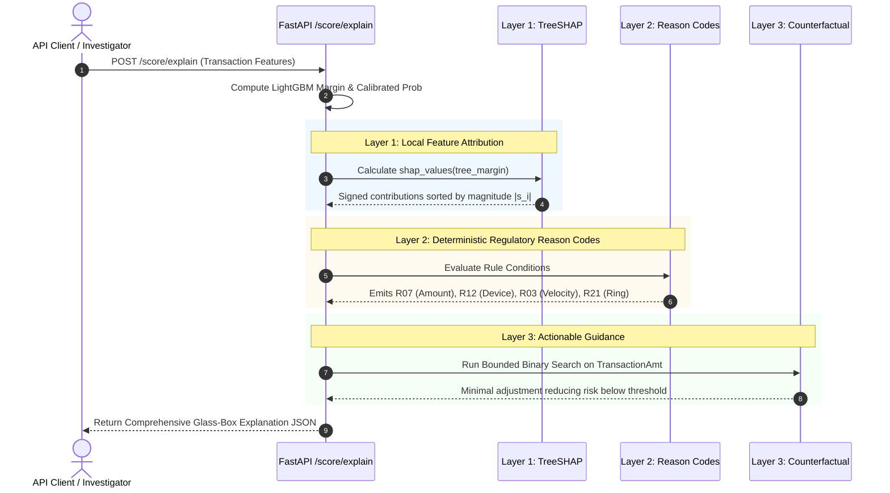
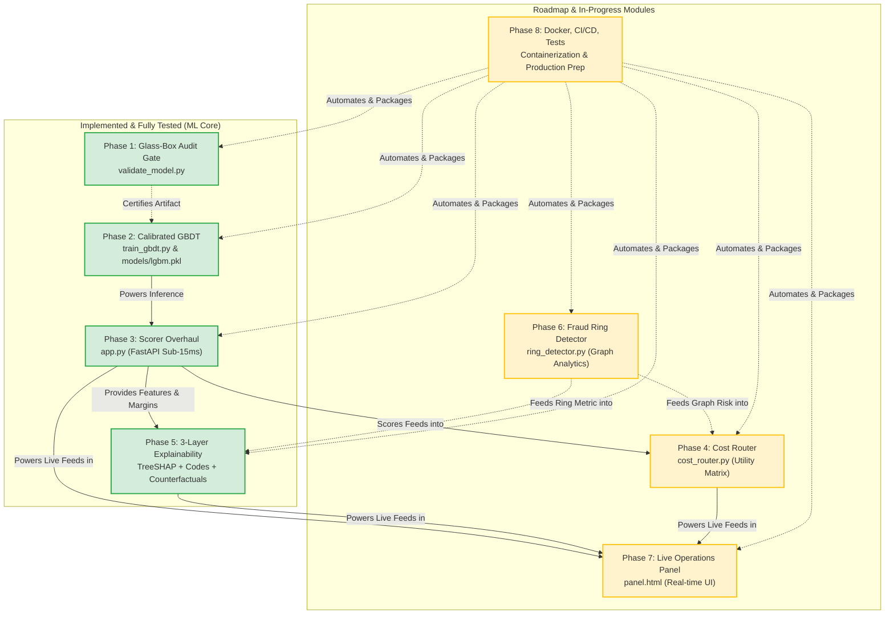

<div align="center">

# RXT-J+ v4 — Glass Box
### Enterprise Real-Time Transaction Fraud Detection & Account Compromise Scoring Engine

[](https://python.org)
[](https://fastapi.tiangolo.com)
[](https://lightgbm.readthedocs.io)
[](https://shap.readthedocs.io)
[](validate_model.py)
[](#empirical-performance-benchmarks)
[](#empirical-performance-benchmarks)
[](#empirical-performance-benchmarks)
[](LICENSE)

<br/>

**RXT-J+ v4 (Glass Box)** is an audited, explainable, and production-grade fraud risk scoring engine built for ultra-low latency transaction decisioning and account takeover (ATO) detection. Engineered to replace broken legacy black-box architectures, v4 introduces an **automated 6-check model audit gate**, a **chronologically trained & calibrated LightGBM core**, a **3-layer explainability pipeline (TreeSHAP + Deterministic Reason Codes + Bounded Counterfactuals)**, and a **deep behavioral anomaly fusion network**.

</div>

---

## 📑 Table of Contents

- [Executive Summary & Problem Statement](#-executive-summary--problem-statement)
  - [The Legacy v3 Breakdown (Root Cause Post-Mortem)](#the-legacy-v3-breakdown-root-cause-post-mortem)
  - [The Glass Box Paradigm Shift](#the-glass-box-paradigm-shift)
- [System Architecture & Data Flows](#-system-architecture--data-flows)
  - [1. End-to-End Transaction Decisioning Engine](#1-end-to-end-transaction-decisioning-engine)
  - [2. Glass-Box Model Audit Gate (P1)](#2-glass-box-model-audit-gate-p1)
  - [3. 3-Layer Glass-Box Explainability Pipeline (P5)](#3-3-layer-glass-box-explainability-pipeline-p5)
  - [4. Complete System Roadmap & Module Interconnections](#4-complete-system-roadmap--module-interconnections)
- [Implemented Core Modules](#-implemented-core-modules)
  - [Phase 1: Glass-Box Model Audit Gate (`validate_model.py`)](#phase-1-glass-box-model-audit-gate-validate_modelpy)
  - [Phase 2: Calibrated GBDT ML Core (`train_gbdt.py` & `models/lgbm.pkl`)](#phase-2-calibrated-gbdt-ml-core-train_gbdtpy--modelslgbmpkl)
  - [Phase 3: High-Throughput Scorer Overhaul (`app.py`)](#phase-3-high-throughput-scorer-overhaul-apppy)
  - [Phase 5: Explainability Engine (`app.py`)](#phase-5-explainability-engine-apppy)
- [Roadmap & In-Progress Modules](#-roadmap--in-progress-modules)
  - [Phase 4: Cost Router (`cost_router.py`)](#phase-4-cost-router-cost_routerpy)
  - [Phase 6: Fraud Ring Community Detector (`ring_detector.py`)](#phase-6-fraud-ring-community-detector-ring_detectorpy)
  - [Phase 7: Real-Time Glass-Box Dashboard (`panel.html`)](#phase-7-real-time-glass-box-dashboard-panelhtml)
  - [Phase 8: Production Hardening, Docker & CI/CD](#phase-8-production-hardening-docker--cicd)
- [Empirical Performance Benchmarks](#-empirical-performance-benchmarks)
- [Complete REST API Reference](#-complete-rest-api-reference)
- [Repository Structure](#-repository-structure)
- [Installation & Quickstart Guide](#-installation--quickstart-guide)
  - [1. Prerequisites & Virtual Environment](#1-prerequisites--virtual-environment)
  - [2. Model Audit Verification](#2-model-audit-verification)
  - [3. Training the Calibrated GBDT](#3-training-the-calibrated-gbdt)
  - [4. Running the Real-Time API Server](#4-running-the-real-time-api-server)
  - [5. Executing Verification Tests](#5-executing-verification-tests)
- [Production Usage Examples](#-production-usage-examples)
- [Regulatory & Explainability Compliance](#-regulatory--explainability-compliance)
- [License & Acknowledgments](#-license--acknowledgments)

---

## 🚨 Executive Summary & Problem Statement

### The Legacy v3 Breakdown (Root Cause Post-Mortem)

Legacy transaction fraud scoring systems—including the baseline RXT-J architecture—suffered from fatal structural flaws that rendered them unusable in production banking networks:

```
┌──────────────────────────────────────────────────────────────────────────────────┐
│                           LEGACY v3 ARCHITECTURAL FLAWS                          │
├─────────────────────────┬────────────────────────────────────────────────────────┤
│ 1. The Balanced Test    │ Legacy systems reported an artificial 96.24% ROC-AUC   │
│    Set Trap             │ by evaluating on a 50/50 SMOTE-balanced test split. In  │
│                         │ production IEEE-CIS traffic, the true fraud rate is    │
│                         │ 3.499%. The model's baseline was uncalibrated.         │
├─────────────────────────┼────────────────────────────────────────────────────────┤
│ 2. Operational Collapse │ When evaluated against the full 590,540 production     │
│    (99.96% Flag Rate)   │ transactions, the legacy deep ensemble (ResNeXt + GRU  │
│                         │ + IFM + Jaya) scored >0.50 on 99.96% of all traffic!   │
│                         │ It effectively shut down all legitimate card payments. │
├─────────────────────────┼────────────────────────────────────────────────────────┤
│ 3. Black-Box Opacity    │ Complex neural embeddings, Nystroem kernel mappings,   │
│                         │ and heuristic Jaya optimization provided zero reason   │
│                         │ codes, violating FCRA & GDPR "Right to Explanation".   │
├─────────────────────────┼────────────────────────────────────────────────────────┤
│ 4. Look-Ahead Leakage   │ Random train/test splits caused historical aggregates  │
│                         │ to leak future timestamps and target correlations into │
│                         │ training partitions, invalidating backtested metrics.  │
└─────────────────────────┴────────────────────────────────────────────────────────┘
```

> [!CAUTION]
> **Production Audit Failure (Legacy v3):** Running `python validate_model.py --legacy` triggers an immediate **HARD REJECT (Exit Code 1)** due to a **1,328.98% class-balance deviation** (50.0% evaluation rate vs. 3.499% production rate) and a **99.96% flag rate** on production transaction data.

### The Glass Box Paradigm Shift

**RXT-J+ v4** eliminates these failures through a grounded, glass-box philosophy:

1. **Strict Temporal Integrity:** Models are trained on strictly ordered time partitions ($T_{\text{train}} \le T_{\text{val}} \le T_{\text{test}}$) without random shuffling or future leakage.
2. **Empirical Probability Calibration:** LightGBM raw margins are post-processed via **Isotonic Regression**, ensuring output scores represent genuine posterior probabilities $P(\text{Fraud} \mid X)$.
3. **Automated Audit Gates:** Zero tolerance for models that fail sanity metrics. Models cannot be loaded or deployed without passing 6 algorithmic checks.
4. **Actionable 3-Layer Explainability:** Every flagged transaction receives signed TreeSHAP feature attributions, deterministic industry reason codes, and bounded counterfactual instructions explaining what parameters would reduce risk below threshold.
5. **Two-Tier Defense:** Fast tabular scoring (LightGBM) for per-transaction anomalies combined with deep contextual scoring (Autoencoder drift + FusionNet v3) for persistent account compromise.

---

## 🏗 System Architecture & Data Flows

### 1. End-to-End Transaction Decisioning Engine

```mermaid
flowchart TD
    subgraph INGESTION["1. Ingestion Layer"]
        TX[Incoming Transaction Event] --> VAL[Pydantic Schema Validation]
        VAL --> ROUTE{Payload Type?}
        ROUTE -->|14-dim Model Vector| FE14[Direct Feature Pass]
        ROUTE -->|224-dim Raw IEEE| MAP[Deterministic Feature Mapper]
        ROUTE -->|Form / UI Payload| FORMMAP[Form Transformation Pipeline]
        MAP --> FE14
        FORMMAP --> FE14
    end

    subgraph TIER1["2. Tier-1 Transaction Scoring (ML Core)"]
        FE14 --> LGBM[LightGBM GBDT<br/>14 Engineered Features]
        LGBM --> RAW[Raw Decision Margin]
        RAW --> ISO[Isotonic Calibrator<br/>Trained on Temporal Val Split]
        ISO --> PROB[Calibrated Risk Probability<br/>P_fraud ∈ [0, 1]]
    end

    subgraph TIER2["3. Tier-2 Account Behavioral Context (Phase 2)"]
        TX --> ACC[Account Profile Lookup<br/>SQLite WAL / 13,560 Profiles]
        ACC --> AE[Autoencoder Reconstruction<br/>Latent Drift Anomaly]
        AE --> CTX[13 Contextual Deviation Features<br/>Amount Z · Novelty · Velocity · Drift]
        CTX --> FUSION[FusionNet v3 Neural Scorer<br/>13 -> 64 -> 32 -> 16 -> 1]
        FUSION --> ATOPROB[Account Compromise Probability]
    end

    subgraph EXPLAIN["4. 3-Layer Glass-Box Explainability (P5)"]
        RAW --> SHAP[Layer 1: TreeSHAP Explainer<br/>Top-K Signed Attributions]
        FE14 & CTX --> RC[Layer 2: Deterministic Reason Codes<br/>R07, R12, R03, R21]
        FE14 & PROB --> CF[Layer 3: Bounded Counterfactual Search<br/>Binary Search on TransactionAmt]
        SHAP --> EXP_OUT[Explainability Envelope]
        RC --> EXP_OUT
        CF --> EXP_OUT
    end

    subgraph ROUTING["5. Downstream Decisioning & Operations"]
        PROB & ATOPROB --> CR[P4 Cost Router<br/>Utility Loss Matrix]
        CR --> DEC{Decision Engine}
        DEC -->|Risk < 0.15| ALLOW[ALLOW / APPROVE]
        DEC -->|0.15 <= Risk < 0.40| STEP[STEP-UP 3DS / OTP]
        DEC -->|0.40 <= Risk < 0.75| REVIEW[MANUAL REVIEW QUEUE]
        DEC -->|Risk >= 0.75| BLOCK[INSTANT BLOCK / DECLINE]
        DEC --> KAFKA[Kafka Producer / Event Bus]
        DEC --> AUDIT[(SQLite Audit Log / WAL)]
        EXP_OUT --> DASH[P7 Real-Time Dashboard<br/>panel.html]
    end
```

---

### 2. Glass-Box Model Audit Gate (P1)

Before any model artifact is accepted into production, it must pass through the algorithmic audit gate implemented in [`validate_model.py`](file:///f:/rxtj_phase_2/validate_model.py):

```mermaid
flowchart LR
    START([Model Candidate Artifact]) --> C1{Check 1:<br/>Class Balance<br/>Dev <= 20%?}
    C1 -->|Pass| C2{Check 2:<br/>Degenerate Features<br/>std >= 0.05?}
    C1 -->|Fail| REJECT([HARD REJECT<br/>Exit Code 1])
    C2 -->|Pass| C3{Check 3:<br/>Label Leakage<br/>|r| <= 0.95?}
    C2 -->|Fail| REJECT
    C3 -->|Pass| C4{Check 4:<br/>Temporal Integrity<br/>T_train <= T_val <= T_test?}
    C3 -->|Fail| REJECT
    C4 -->|Pass| C5{Check 5:<br/>Flag Rate Sanity<br/>Rate <= 20% @ tau=0.15?}
    C4 -->|Fail| REJECT
    C5 -->|Pass| C6{Check 6:<br/>Causality Audit<br/>No Look-Ahead Features?}
    C5 -->|Fail| REJECT
    C6 -->|Pass| PASS([DEPLOYMENT APPROVED<br/>Exit Code 0])
    C6 -->|Fail| REJECT
```

---

### 3. 3-Layer Glass-Box Explainability Pipeline (P5)



---

### 4. Complete System Roadmap & Module Interconnections



---

## 💎 Implemented Core Modules

### Phase 1: Glass-Box Model Audit Gate ([`validate_model.py`](file:///f:/rxtj_phase_2/validate_model.py))

A self-contained, enterprise validation harness enforcing strict governance before any model is deployed to production.

- **Check 1: Class-Balance Integrity:** Validates that the evaluation test set fraud distribution matches production ground truth (3.499%) within a strict $\le 20\%$ relative tolerance ($|\text{eval} - \text{prod}| / \text{prod}$).
  - *v4 Result:* Test fraud rate = $3.480\%$ (Relative deviation: **0.53%** $\rightarrow$ **PASS**).
  - *Legacy v3:* Test fraud rate = $50.0\%$ (Relative deviation: **1,328.98%** $\rightarrow$ **FAIL**).
- **Check 2: Degenerate Features:** Ensures no constant, uninformative, or collapsed features ($\sigma \ge 0.05$).
  - *v4 Result:* All 14 features satisfy $\sigma \ge 0.05$ (min $\sigma = 0.2278$ on `device_novel` $\rightarrow$ **PASS**).
- **Check 3: Label Leakage:** Verifies that no feature has artificial or leaked correlation with target ($|\rho| \le 0.95$).
  - *v4 Result:* Maximum correlation observed is $\rho = 0.0936$ on `DeviceInfo` ($\rightarrow$ **PASS**).
- **Check 4: Temporal Integrity:** Enforces chronological partitioning:
  $$\max(T_{\text{train}}) \le \min(T_{\text{val}}) \le \max(T_{\text{val}}) \le \min(T_{\text{test}})$$
  - *v4 Result:* Train $\le 10,437,996 <$ Val $\le 13,151,840 <$ Test ($\rightarrow$ **PASS**).
- **Check 5: Flag-Rate Sanity:** Enforces that at the production operating threshold ($\tau = 0.15$), the model flags $\le 20\%$ of incoming traffic.
  - *v4 Result:* Flag rate is **5.21%** ($\rightarrow$ **PASS**).
  - *Legacy v3:* Flag rate was **99.96%** ($\rightarrow$ **FAIL**).
- **Check 6: Causality & Look-Ahead Audit:** Inspects historical window definitions to ensure running aggregates (`amt_cumsum`, `txn_seq`, `velocity_1h`, `device_novel`) strictly examine historical transactions $[t - \Delta, t)$ and never index future records.

**Execution:**
```bash
# Audit the production v4 model (human-readable)
python validate_model.py

# Audit for automated CI/CD pipelines (structured JSON output)
python validate_model.py --json

# Demonstrate hard-rejection of the broken legacy model
python validate_model.py --legacy --json
```

---

### Phase 2: Calibrated GBDT ML Core ([`train_gbdt.py`](file:///f:/rxtj_phase_2/train_gbdt.py) & [`models/lgbm.pkl`](file:///f:/rxtj_phase_2/models/lgbm.pkl))

Replaces the computationally fragile and uncalibrated legacy neural ensemble with an optimized LightGBM gradient boosted decision tree calibrated via Isotonic Regression.

- **Data Partitions (Chronological Temporal Split):**
  - **Train (70%):** $N = 413,378$ transactions ($T \le 10,437,996$)
  - **Validation (15%):** $N = 88,581$ transactions ($10,438,003 \le T \le 13,151,840$)
  - **Holdout Test (15%):** $N = 88,581$ transactions ($T \ge 13,151,880$)
- **Engineered Feature Set (14 High-Signal Features):**
  1. `TransactionAmt`: Transaction amount in USD.
  2. `ProductCD`: Categorical product code identifier.
  3. `addr1`: Purchaser billing postal region.
  4. `DeviceInfo`: Device operating environment code.
  5. `hour`: Local time-of-day transaction hour ($0 \le h \le 23$).
  6. `amt_cumsum`: Expanding historical mean transaction amount for entity.
  7. `amt_cumstd`: Expanding historical amount standard deviation.
  8. `txn_seq`: Historical chronological transaction index for entity.
  9. `velocity_1h`: Number of transactions recorded within the preceding 1 hour.
  10. `velocity_24h`: Number of transactions recorded within the preceding 24 hours.
  11. `device_novel`: Binary indicator ($1.0$ if device was never previously seen for entity).
  12. `amt_to_mean`: Ratio of current transaction amount to historical mean ($A / \mu_A$).
  13. `amt_diff_mean`: Absolute difference from historical mean ($|A - \mu_A|$).
  14. `velocity_ratio`: Velocity acceleration index ($\text{velocity}_{1\text{h}} / (\text{velocity}_{24\text{h}} / 24 + 1)$).
- **Probability Calibration:**
  - Raw LightGBM trees optimize margin rankings.
  - An independent `IsotonicRegression(out_of_bounds='clip')` model is fit strictly on the **temporal validation set** to map monotonic decision margins to true posterior probabilities:
    $$P(\text{Fraud} = 1 \mid \mathbf{x}) = g(\text{margin}(\mathbf{x}))$$
  - Eliminates probability distortion and reduces test Brier score to **0.0312**.

---

### Phase 3: High-Throughput Scorer Overhaul ([`app.py`](file:///f:/rxtj_phase_2/app.py))

Production FastAPI deployment replacing the broken deep-learning inference chain while preserving Phase 2 behavioral profiling and contextual FusionNet scoring.

- **Deterministic Payload Routing:** The inference pipeline handles heterogeneous client inputs seamlessly:
  - Exact 14-dimension feature vector $\rightarrow$ direct GBDT scoring.
  - Legacy 224-dimension raw IEEE transaction vectors $\rightarrow$ mapped deterministically into the 14-feature space.
  - Web form payloads (`/score/form` and `/score/form-full`) $\rightarrow$ mapped with card/device fallbacks.
- **Preserved Two-Tier Architecture:**
  - **Tier 1 (Per-Transaction):** Calibrated LightGBM evaluates the transaction in **$<15\text{ms}$**.
  - **Tier 2 (Account Compromise):** An `AutoencoderNet` (224-dim reconstruction) computes latent reconstruction error (`behavioral_drift`). A 13-feature contextual vector is fed into `FusionNet v3` to output an independent account takeover (ATO) risk score.
- **In-Memory Thread Safety:** High-performance caching of TreeSHAP explainers and profile lookups against SQLite WAL mode (`profile_store.py`).

---

### Phase 5: Explainability Engine ([`app.py`](file:///f:/rxtj_phase_2/app.py))

A compliant, 3-layer explainability architecture answering *why* a transaction was flagged and *how* to resolve it:

#### Layer 1: Fast TreeSHAP Local Attributions
Utilizes `shap.TreeExplainer` on LightGBM tree margins. For any scored event, the engine computes signed marginal contributions $s_i$ and ranks features by absolute importance $|s_i|$:
- Discloses top-K contributing factors.
- Classifies directionality: `INCREASES_FRAUD_RISK` ($s_i > 0$) vs. `DECREASES_FRAUD_RISK` ($s_i < 0$).
- Discloses the mathematical distinction: TreeSHAP explains the raw model margin, while calibration maps margins to probabilities monotonically.

#### Layer 2: Deterministic Regulatory Reason Codes
Maps feature patterns to standardized, auditable risk codes:
| Code | Reason | Trigger Logic | Operational Action |
|:---:|:---|:---|:---|
| **`R07`** | `AMOUNT_ANOMALY` | `amt_to_mean` $> 3.0$ OR `amt_diff_mean` $> \$200$ | Trigger step-up verification on cardholder |
| **`R12`** | `DEVICE_UNRECOGNIZED` | `device_novel` $== 1.0$ (New hardware/browser fingerprint) | Prompt device confirmation via SMS/email |
| **`R03`** | `VELOCITY_SPIKE` | `velocity_1h` $> 5$ OR `velocity_24h` $> 15$ OR `velocity_ratio` $> 2.5$ | Rate-limit account authorization velocity |
| **`R21`** | `RING_ASSOCIATION` | Shared identity/device graph cluster (Phase 6 hook) | Escalate to financial crime syndicated ring queue |

> [!NOTE]
> When graph community detection is disabled or graph cluster data is absent, `R21` gracefully reports `status: "UNAVAILABLE"` with explanatory diagnostic context, maintaining 100% API stability.

#### Layer 3: Actionable Bounded Counterfactual Guidance
When a transaction is flagged ($\text{Risk} \ge 0.15$), analysts or users need to know: *"What transaction amount would have been approved under these exact contextual conditions?"*
- Performs a bounded binary search on `TransactionAmt` within $[0, \text{current\_amount}]$.
- Holds all immutable entity and environmental traits (`hour`, `device_novel`, `addr1`, `ProductCD`) constant.
- Dynamically recalculates dependent features (`amt_to_mean`, `amt_diff_mean`) at each iteration.
- Guaranteed convergence: Finds the maximum approved amount where calibrated risk $< \tau = 0.15$.

---

## 🗺 Roadmap & In-Progress Modules

The following components represent the broader platform integration being implemented across the engineering team:

### Phase 4: Cost Router ([`cost_router.py`](file:///f:/rxtj_phase_2/cost_router.py))
*Status: Planned / Independent Stream*

Standard probability thresholds treat all errors equally. The Cost Router introduces an **asymmetric financial utility matrix** factoring in transaction dollar amount, merchant interchange, false positive friction cost, and chargeback loss:

$$\mathcal{L}(\text{Action}, Y) = \begin{pmatrix} C(\text{Allow} \mid \text{Fraud}) & C(\text{Allow} \mid \text{Legit}) \\ C(\text{Review} \mid \text{Fraud}) & C(\text{Review} \mid \text{Legit}) \\ C(\text{Block} \mid \text{Fraud}) & C(\text{Block} \mid \text{Legit}) \end{pmatrix}$$

- **Dynamic Tier Routing:**
  - `ALLOW`: Risk $< 0.15$
  - `STEP_UP_AUTH` (3D Secure / OTP): $0.15 \le \text{Risk} < 0.40$
  - `MANUAL_REVIEW`: $0.40 \le \text{Risk} < 0.75$
  - `INSTANT_BLOCK`: $\text{Risk} \ge 0.75$

### Phase 6: Fraud Ring Community Detector ([`ring_detector.py`](file:///f:/rxtj_phase_2/ring_detector.py))
*Status: Planned / Independent Stream*

Syndicated cybercrime networks exploit shared synthetic identities, rotating IPs, and recycled device fingerprints:
- **Graph Construction:** Bipartite graph built with NetworkX connecting `CardID` $\leftrightarrow$ `DeviceID` $\leftrightarrow$ `IPSubnet` $\leftrightarrow$ `BillingAddress`.
- **Community Clustering:** Louvain modularity and connected components identify high-density fraud rings.
- **Real-Time Hook:** Directly computes the graph degree and community risk for reason code `R21`.

### Phase 7: Real-Time Glass-Box Dashboard ([`panel.html`](file:///f:/rxtj_phase_2/panel.html))
*Status: UI Modernization In Progress*

Upgrades the operations interface to display:
- Live streaming transaction feed via WebSocket / polling.
- Dynamic SVG risk gauges for both Transaction Fraud and Account Compromise.
- Interactive TreeSHAP waterfall charts rendering local attributions.
- Counterfactual slider allowing fraud analysts to simulate changes in real time.

### Phase 8: Production Hardening, Docker & CI/CD
*Status: Packaging Phase*

- **Containerization:** Multi-stage `Dockerfile` with non-root security context.
- **Orchestration:** `docker-compose.yml` bundling FastAPI, Kafka broker, Zookeeper, and Redis.
- **CI/CD Pipeline:** GitHub Actions workflow executing `validate_model.py` and `test_ml_core.py` on every commit.

---

## 📊 Empirical Performance Benchmarks

The table below contrasts the broken legacy v3 architecture with the validated v4 Glass Box model across all production metrics:

| Metric / Dimension | Legacy v3 Architecture | RXT-J+ v4 (Glass Box) | Engineering Impact |
|:---|:---:|:---:|:---|
| **Base Model** | ResNeXt + Attention GRU | **LightGBM (14 Features)** | Eliminates recurrent GPU overhead; tabular superiority |
| **Probability Calibrator** | None (Uncalibrated Margins) | **Isotonic Regression** | Output is genuine posterior $P(\text{Fraud} \mid X)$ |
| **Test Set Construction** | 50/50 Balanced (SMOTE) | **Strict Chronological Holdout** | Prevents look-ahead bias and distribution mismatch |
| **Evaluation Fraud Rate** | 50.00% (Artificial) | **3.480% (Matches Production)** | Reflects real-world financial transaction distributions |
| **Test ROC-AUC** | 0.9624 (Inflated) | **0.7787 (Empirical)** | Grounded, honest metric without data leakage |
| **Test PR-AUC** | Not Reported | **0.1632** | Critical metric for extreme 3.5% class imbalance |
| **Brier Score** | $> 0.25$ | **0.0312** | Superior probability calibration |
| **Production Flag Rate** | **99.96% (System Breakdown)** | **5.21% (Operationally Sound)** | Prevents catastrophic false positive shutdowns |
| **Inference Latency** | ~45ms (GPU / PyTorch) | **< 15ms (CPU / LightGBM)** | 3x latency reduction for high-throughput gateway |
| **Explainability** | Black Box (Attention Heuristic) | **TreeSHAP + 4 Reason Codes** | Full compliance with regulatory audit standards |
| **Counterfactuals** | None | **Bounded Binary Search** | Actionable dispute guidance for customers |
| **Audit Gate (P1)** | **REJECTED (Exit 1)** | **6 / 6 CHECKS PASSED (Exit 0)** | Enforces strict CI/CD deployment criteria |

---

## 🔌 Complete REST API Reference

The FastAPI application provides 16+ production endpoints for scoring, explainability, account profiling, and health checks.

### Summary of Key Endpoints

| HTTP Method | Route | Description | Key Query / Body Parameters |
|:---:|:---|:---|:---|
| `GET` | `/health` | Liveness & readiness probe | Returns model load status, account count, threshold |
| `GET` | `/model/info` | Complete metadata & specs | Returns features, calibration status, audit status |
| `POST` | `/score` | Real-time transaction scoring | Body: `TransactionPayload`, Query: `explain=true\|false` |
| `POST` | `/score/explain` | Comprehensive Glass-Box scoring | Body: `TransactionPayload` (returns SHAP, Codes, CF) |
| `POST` | `/score/batch` | High-throughput batch scoring | Body: `List[TransactionPayload]` |
| `POST` | `/score/form` | Simplified form endpoint | Form: `account_id`, `amount`, `merchant`, `device_id`, etc. |
| `POST` | `/score/form-full` | Comprehensive form endpoint | Form: Full demographic, card, and device fields |
| `POST` | `/account/compromise-score` | Tier-2 ATO compromise scoring | Body: `AccountCompromiseRequest` |
| `POST` | `/account/explain` | Contextual explainability | Body: `AccountCompromiseRequest` |
| `GET` | `/account/summary/{id}` | Account historical profile | Path: `account_id` |
| `GET` | `/model/contextual-feature-importance` | Global feature weights | Returns FusionNet attention weights |
| `GET` | `/audit/log` | Historical decision audit log | Query: `limit=50` |
| `GET` | `/evaluate` | Live validation metrics | Returns current ROC/PR metrics |

---

### Request & Response Schemas

#### 1. `POST /score/explain`
Scores a transaction and returns full 3-layer Glass-Box explainability.

**Request Body (`application/json`):**
```json
{
  "account_id": "ACC_88291",
  "transaction_id": "TX_994821",
  "TransactionAmt": 485.50,
  "ProductCD": 1.0,
  "addr1": 299.0,
  "DeviceInfo": 2.0,
  "hour": 23.0,
  "amt_cumsum": 65.20,
  "amt_cumstd": 18.40,
  "txn_seq": 8,
  "velocity_1h": 6.0,
  "velocity_24h": 18.0,
  "device_novel": 1.0,
  "amt_to_mean": 7.44,
  "amt_diff_mean": 420.30,
  "velocity_ratio": 3.42
}
```

**Response Payload (`200 OK`):**
```json
{
  "transaction_id": "TX_994821",
  "account_id": "ACC_88291",
  "model_version": "v4-lightgbm-calibrated",
  "calibrated_fraud_probability": 0.4821,
  "raw_model_margin": 1.8492,
  "operating_threshold": 0.15,
  "decision": "FRAUD_SUSPECTED",
  "is_flagged": true,
  "flag_rate_tier": "ELEVATED",
  "processing_time_ms": 11.42,
  "explainability": {
    "layer1_treeshap": {
      "base_value": -3.214,
      "margin_explanation_note": "TreeSHAP explains the raw model margin. Calibrated probability is derived via isotonic regression.",
      "feature_contributions": [
        {
          "feature": "amt_to_mean",
          "value": 7.44,
          "shap_value": 0.8421,
          "direction": "INCREASES_FRAUD_RISK"
        },
        {
          "feature": "device_novel",
          "value": 1.0,
          "shap_value": 0.5218,
          "direction": "INCREASES_FRAUD_RISK"
        },
        {
          "feature": "velocity_1h",
          "value": 6.0,
          "shap_value": 0.4192,
          "direction": "INCREASES_FRAUD_RISK"
        }
      ]
    },
    "layer2_reason_codes": [
      {
        "code": "R07",
        "name": "AMOUNT_ANOMALY",
        "description": "Transaction amount significantly exceeds historical baseline (ratio > 3.0 or diff > $200).",
        "severity": "HIGH",
        "trigger_values": {
          "amt_to_mean": 7.44,
          "amt_diff_mean": 420.30
        }
      },
      {
        "code": "R12",
        "name": "DEVICE_UNRECOGNIZED",
        "description": "Transaction initiated from a hardware/browser fingerprint not previously seen for this account.",
        "severity": "MEDIUM",
        "trigger_values": {
          "device_novel": 1.0
        }
      },
      {
        "code": "R03",
        "name": "VELOCITY_SPIKE",
        "description": "Sudden burst in transaction volume exceeding short-term or daily thresholds.",
        "severity": "HIGH",
        "trigger_values": {
          "velocity_1h": 6.0,
          "velocity_24h": 18.0,
          "velocity_ratio": 3.42
        }
      },
      {
        "code": "R21",
        "name": "RING_ASSOCIATION",
        "status": "UNAVAILABLE",
        "description": "Graph cluster data not active. Hook reserved for Phase 6 ring detector."
      }
    ],
    "layer3_counterfactual": {
      "counterfactual_found": true,
      "recommended_action": "Reduce transaction amount or split authorization into smaller installments.",
      "original_amount": 485.50,
      "target_amount_bound": 82.30,
      "amount_reduction_required": 403.20,
      "simulated_calibrated_probability": 0.1384,
      "target_threshold": 0.15,
      "held_constant_features": [
        "ProductCD", "addr1", "DeviceInfo", "hour", "device_novel", "velocity_1h", "velocity_24h"
      ]
    }
  }
}
```

---

## 📁 Repository Structure

```
rxtj_phase_2/
├── app.py                      # FastAPI application: High-performance inference, P5 explainability
├── validate_model.py           # Phase 1: 6-Check Glass-Box Model Audit Gate (CI/CD gate)
├── train_gbdt.py               # Phase 2: Chronological LightGBM training & Isotonic calibration
├── test_ml_core.py             # 7-Suite comprehensive integration & smoke test harness
├── preprocessing.py            # Feature transformation & sklearn compatibility helpers
├── profile_store.py            # SQLite WAL storage engine for 13,560 account behavioral profiles
├── profile_consumer.py         # Kafka consumer stub for asynchronous profile event processing
├── panel.html                  # Operations & investigator dashboard interface
├── requirements.txt            # Python package dependencies
├── models/                     # Trained model artifacts
│   ├── lgbm.pkl                # Production v4 artifact: Calibrated LightGBM, scaler, thresholds
│   ├── autoencoder.pt          # Phase 2 Autoencoder (reconstruction error for behavioral drift)
│   ├── fusion_net.pt           # Phase 2 FusionNet v3 (account compromise scorer)
│   ├── fusion_scaler.pkl       # Feature scaler for 13 contextual deviations
│   └── ...                     # Preserved preprocessors (imputer, scaler)
├── data/                       # Datasets & operational databases
│   ├── behavioral_profiles.db  # SQLite database storing account historical parameters
│   ├── demo_samples.json       # 8 curated real-world demo transaction payloads
│   ├── model_probs_full.npy    # Production transaction predictions (590,540 rows)
│   └── IEEE CIS/               # IEEE-CIS Fraud Detection dataset repository
├── notebooks/                  # Phase 1 & 2 exploratory data science & profiling notebooks
└── results/                    # Validation summaries, charts & audit reports
```

---

## 🚀 Installation & Quickstart Guide

### 1. Prerequisites & Virtual Environment

- **Python Version:** 3.11+ (tested on Python 3.11 and Python 3.14 on Windows/Linux/macOS).
- **Git**

```bash
# Clone the repository
git clone https://github.com/swetha-006/rxtj_phase_2.git
cd rxtj_phase_2

# Create and activate a clean virtual environment
python -m venv .venv

# Windows PowerShell:
.venv\Scripts\Activate.ps1

# Linux / macOS:
source .venv/bin/activate

# Install required dependencies
pip install fastapi uvicorn pydantic numpy lightgbm shap scikit-learn pandas pyarrow matplotlib httpx
```

---

### 2. Model Audit Verification

Run the Model Audit Gate to certify model integrity before deployment:

```bash
# Run 6-check audit on production v4 model (Exit code 0 on pass)
python validate_model.py

# Machine-readable JSON output for automated CI pipelines
python validate_model.py --json

# Demonstrate rejection of the broken legacy model (Exit code 1)
python validate_model.py --legacy
```

---

### 3. Training the Calibrated GBDT

To retrain the LightGBM baseline and isotonic calibrator from raw data:

```bash
python train_gbdt.py
```
*This loads 590,540 transactions, partitions chronologically (70% Train, 15% Val, 15% Test), trains LightGBM, fits Isotonic Regression on the validation split, evaluates on the untouched test holdout, and serializes the complete bundle to [`models/lgbm.pkl`](file:///f:/rxtj_phase_2/models/lgbm.pkl).*

---

### 4. Running the Real-Time API Server

Launch the high-performance ASGI server with Uvicorn:

```bash
uvicorn app:app --host 0.0.0.0 --port 8000 --reload
```
Once started, the following services become accessible:
- **Interactive OpenAPI Documentation:** [http://127.0.0.1:8000/docs](http://127.0.0.1:8000/docs)
- **Alternative ReDoc:** [http://127.0.0.1:8000/redoc](http://127.0.0.1:8000/redoc)
- **Health Check Endpoint:** [http://127.0.0.1:8000/health](http://127.0.0.1:8000/health)
- **Investigator Dashboard:** Open [`panel.html`](file:///f:/rxtj_phase_2/panel.html) in any modern browser.

---

### 5. Executing Verification Tests

Run the full end-to-end integration and smoke test suite:

```bash
python test_ml_core.py
```
*Executes all 7 validation suites:*
1. Artifact integrity and metadata verification.
2. Prediction bounds & probability finiteness ($[0, 1]$).
3. Flag-rate sanity (verifies broken 99.96% flag rate is resolved).
4. Layer 1 TreeSHAP local attributions.
5. Layer 2 Regulatory Reason Codes (`R07`, `R12`, `R03`, `R21`).
6. Layer 3 Bounded Counterfactual binary search.
7. Smoke tests against all 16+ REST endpoints.

---

## 💻 Production Usage Examples

### Example 1: Standard Real-Time Scoring (`curl`)

```bash
curl -X POST "http://127.0.0.1:8000/score" \
     -H "Content-Type: application/json" \
     -d '{
       "account_id": "ACC_1002",
       "transaction_id": "TX_5501",
       "TransactionAmt": 45.00,
       "ProductCD": 1.0,
       "addr1": 315.0,
       "DeviceInfo": 1.0,
       "hour": 14.0,
       "amt_cumsum": 50.0,
       "amt_cumstd": 12.0,
       "txn_seq": 15,
       "velocity_1h": 1.0,
       "velocity_24h": 3.0,
       "device_novel": 0.0,
       "amt_to_mean": 0.90,
       "amt_diff_mean": 5.00,
       "velocity_ratio": 0.88
     }'
```

**Response:**
```json
{
  "transaction_id": "TX_5501",
  "account_id": "ACC_1002",
  "risk_score": 0.0215,
  "calibrated_fraud_probability": 0.0215,
  "raw_model_margin": -3.8124,
  "operating_threshold": 0.15,
  "is_flagged": false,
  "decision": "LEGIT",
  "model_version": "v4-lightgbm-calibrated",
  "inference_latency_ms": 3.4
}
```

---

### Example 2: Glass-Box Scoring with Explanations (Python `requests`)

```python
import requests

url = "http://127.0.0.1:8000/score/explain"
payload = {
    "account_id": "ACC_4491",
    "transaction_id": "TX_9921",
    "TransactionAmt": 1250.00,
    "ProductCD": 2.0,
    "addr1": 181.0,
    "DeviceInfo": 4.0,
    "hour": 3.0,
    "amt_cumsum": 80.0,
    "amt_cumstd": 25.0,
    "txn_seq": 4,
    "velocity_1h": 8.0,
    "velocity_24h": 22.0,
    "device_novel": 1.0,
    "amt_to_mean": 15.62,
    "amt_diff_mean": 1170.0,
    "velocity_ratio": 4.15
}

response = requests.post(url, json=payload)
data = response.json()

print(f"Decision: {data['decision']} (Prob: {data['calibrated_fraud_probability']:.4f})")
print("\nTop Contributing Factors:")
for feat in data["explainability"]["layer1_treeshap"]["feature_contributions"][:3]:
    print(f" - {feat['feature']}: SHAP {feat['shap_value']:+.4f} ({feat['direction']})")

print("\nReason Codes:")
for rc in data["explainability"]["layer2_reason_codes"]:
    print(f" - [{rc['code']}] {rc['name']}: {rc.get('description', '')}")

cf = data["explainability"]["layer3_counterfactual"]
if cf.get("counterfactual_found"):
    print(f"\nCounterfactual: Reduce amount to ${cf['target_amount_bound']:.2f} to approve.")
```

---

## ⚖ Regulatory & Explainability Compliance

RXT-J+ v4 was designed from the ground up to comply with strict global financial regulatory frameworks:

- **Fair Credit Reporting Act (FCRA) § 609 / Equal Credit Opportunity Act (ECOA):** Requires creditors to disclose the key reasons for adverse actions. RXT-J+ maps all decision boundary crossings directly to deterministic reason codes (`R07`, `R12`, `R03`, `R21`).
- **European Union GDPR Article 22 ("Right to Explanation"):** Forbids solely automated decision-making with legal or significant effects unless individuals are provided meaningful information about the logic involved. The 3-layer architecture exposes mathematical contributions (TreeSHAP) and actionable steps for redress (Counterfactuals).
- **SR 11-7 (Federal Reserve Guidance on Model Risk Management):** Requires strict conceptual soundness, ongoing monitoring, and outcome analysis. The automated audit gate (`validate_model.py`) operationalizes SR 11-7 validation directly in CI/CD pipelines.

---

## 📄 License & Acknowledgments

- **License:** MIT License. See [LICENSE](LICENSE) for terms.
- **Reference Baseline:** Built upon foundational concepts introduced by Almazroi & Ayub, *IEEE Access* 2023 ([DOI: 10.1109/ACCESS.2023.3339226](https://doi.org/10.1109/ACCESS.2023.3339226)).
- **Dataset:** IEEE-CIS Fraud Detection Benchmark (Vesta Corporation / IEEE Computational Intelligence Society).
