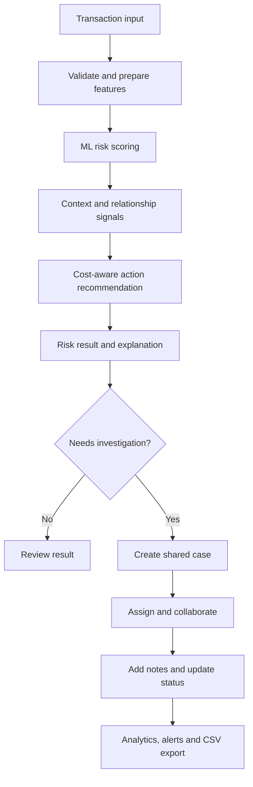

<div align="center">

# 🛡️ RXT-J+ Guardian
### Intelligent Payment Fraud Detection & Investigation Platform

**Score risk. Explain decisions. Prioritize reviews. Coordinate investigations.**

<p>
  
  
  
  
  
  
</p>

[Overview](#-project-overview) · [Problem](#-problem-statement) · [Solution](#-the-solution) · [Features](#-key-features) · [Workflow](#-end-to-end-workflow) · [Setup](#-quick-start) · [API](#-api-reference) · [Security](#-security--limitations)

</div>

---

## 📌 Project overview

**RXT-J+ Guardian** is a fraud-risk scoring and investigation prototype for digital payment transactions. It combines a machine-learning scoring API with decision-cost routing, contextual risk signals, graph-based relationship analysis, reason-code explanations, and a browser-based operations dashboard.

The project also includes authenticated user accounts and team workspaces. Analysts can organize shared investigations, track case status, add notes, review high-priority cases, inspect workspace metrics, and export case data to CSV.

> **Important:** Guardian provides risk scores and recommended actions. It does not connect to a bank, payment processor, card network, or live authorization system. Treat outputs as decision support—not as a guarantee that a transaction is fraudulent or legitimate.

## 🎯 Problem statement

Digital payment fraud is difficult to detect reliably because fraud is rare compared with legitimate activity, attack patterns change, and a single signal rarely tells the full story. A fraud team must balance several competing outcomes:

- **Fraud losses:** missing a fraudulent transaction can create direct financial loss.
- **False positives:** blocking a legitimate customer creates friction, support costs, and potential customer churn.
- **Review capacity:** investigators cannot manually inspect every transaction flagged by a model.
- **Coordinated attacks:** multiple accounts may share devices, addresses, or other attributes that are not suspicious when viewed transaction by transaction.
- **Explainability:** reviewers need a comprehensible rationale for a risk recommendation, not only a score.
- **Operational handoff:** a risk signal is less useful if it cannot be assigned, discussed, tracked, and audited by a team.

A single fixed probability threshold does not address all of these needs. Nor does a high model metric by itself guarantee useful decisions in a severely imbalanced, real-world setting.

## 💡 The solution

Guardian brings risk scoring and case operations into one demonstrator workflow:

1. **Prepare transaction context** from supplied fields and derived behavioural or historical signals.
2. **Estimate fraud risk** using the project's calibrated LightGBM scoring path, with additional contextual/fusion components available in the codebase.
3. **Evaluate a recommended action** through a cost-aware router that compares the expected costs of allowing, challenging, or blocking a transaction.
4. **Enrich the result** with relationship/ring signals and explanatory reason codes where supported by the request path.
5. **Present results** through the API and dashboard so an operator can inspect risk and supporting information.
6. **Create a shared investigation** when a transaction needs follow-up, then assign work, add notes, update status, review alerts, and export case records.

The goal is not to automate every fraud decision. It is to help reviewers make more consistent, context-aware decisions and move from a model output to a traceable investigation.

## ✨ Key features

### 1. Transaction risk scoring

- FastAPI service with validated request/response schemas.
- Calibrated LightGBM model assets and feature transformation code.
- Single-transaction and batch scoring routes.
- Demo samples and model metadata endpoints for exploration.
- Optional explanation paths for supported scoring endpoints.

### 2. Cost-aware action recommendations

The cost router compares the estimated expected cost of three conceptual actions:

- **ALLOW** — accept the transaction without an additional challenge.
- **STEP UP** — request an additional verification step.
- **BLOCK** — decline or stop the transaction in the modeled workflow.

The router is designed to account for transaction amount, estimated fraud probability, and configurable cost assumptions rather than relying only on one global risk threshold. The returned action is a recommendation; no real payment is authorized or blocked by this demo.

### 3. Explainability and reason codes

The codebase includes model explanation logic, feature-contribution analysis, reason-code generation, and bounded counterfactual guidance for supported paths. These mechanisms are intended to help an analyst understand which signals influenced a recommendation.

Explanations are model- and data-dependent. They should be reviewed and validated before being used for regulated adverse-action decisions.

### 4. Fraud-ring and relationship analysis

- Graph-oriented analysis of related account, device, and address signals.
- Ring graph and ring metric endpoints.
- Relationship enrichment that can surface patterns that are difficult to see from an isolated transaction.
- Handling for missing or sentinel-like entity values in graph logic.

Graph output is a lead for investigation—not proof of coordinated fraud.

### 5. User accounts and personal records

- Register, sign in, inspect the current user, and sign out.
- Session-cookie-based authentication.
- User-scoped record synchronization endpoints.
- Password hashing and hashed opaque session tokens in the SQLite account store.

### 6. Team workspaces and collaboration

- Create and list workspaces.
- Invite teammates with workspace roles.
- Accept invitations.
- View workspace members and their roles.
- Create shared investigation cases tied to transaction IDs.
- Add investigation notes and update case statuses.
- Inspect workspace audit events.

The workspace roles in the current implementation are `owner`, `admin`, `reviewer`, and `viewer`. Invitations are suitable for local demonstration: the API returns the invitation token rather than delivering an email.

### 7. Stage 3 operations tools

- **Workspace analytics:** total, assigned, unassigned, and resolved-case metrics, plus recent case-creation summaries.
- **Priority alerts:** a workspace view of unresolved high- and critical-priority cases.
- **Case filtering:** server-side filters for status, priority, assignment, and text search where supported by the API.
- **CSV export:** export workspace case records for offline review and reporting.
- **Access checks:** workspace endpoints check membership before returning organization data.

Alerts currently derive from investigation cases. They are not live payment-stream alerts, and the project does not send external email, SMS, or push notifications.

### 8. Operational and developer support

- Interactive OpenAPI/Swagger documentation.
- Health and model-information endpoints.
- Automated tests for API behavior, routing, accounts, graph logic, workspaces, and Stage 3 operations.
- Dockerfile and Docker Compose configuration.
- CI workflow and model validation tooling in the repository.

## 🔄 End-to-end workflow



### Typical analyst journey

1. Sign in to Guardian or create a demo account.
2. Review the dashboard and use a sample transaction or submit a scoring request.
3. Inspect the score, recommended action, and available explanation or relationship signals.
4. Open **Team Workspaces** and create a workspace, or select one you already belong to.
5. Invite teammates if collaboration is needed. For the demo, copy the returned invitation token and have the invitee accept it while signed in to the appropriate account.
6. Create a case using a transaction ID and a descriptive title; select a priority.
7. Track the case by changing its status and adding investigation notes.
8. Review workspace analytics and high-priority alerts.
9. Export case records to CSV when an offline report is useful.
10. Review the workspace audit history when you need to inspect recorded activity.

## 🧱 Architecture

```text
Browser UI (guardian.html / panel.html)
              │
              ▼
        FastAPI application (app.py)
              │
     ┌────────┼───────────────┐
     ▼        ▼               ▼
 Risk/ML   Cost router     Graph/ring analysis
 pipeline  (cost_router)   (ring_detector)
     │        │               │
     └────────┼───────────────┘
              ▼
      Scoring response / explanation

Account service ───────── SQLite account/session store
Workspace service ─────── SQLite org/case/note/audit tables
              │
              ▼
     Analytics / alerts / CSV export
```

### Main modules

| File or directory | Responsibility |
|---|---|
| `app.py` | FastAPI application, scoring routes, health/model endpoints, auth and workspace APIs |
| `guardian.html` | Main Guardian browser interface, including team workspace operations |
| `panel.html` | Additional/legacy model dashboard interface |
| `guardian_accounts.py` | User registration, password hashing, sessions, user-scoped records |
| `guardian_orgs.py` | Workspaces, membership, invitations, cases, notes, and audit events |
| `cost_router.py` | Cost-sensitive action recommendation logic |
| `ring_detector.py` | Relationship graph and fraud-ring signals |
| `profile_store.py` / `profile_consumer.py` | Behavioural profile support and optional event consumption components |
| `preprocessing.py` | Input preparation and feature preprocessing helpers |
| `models/` | Serialized model and preprocessing assets required by scoring paths |
| `data/` | Demo data, feature metadata, profile data, and local runtime data |
| `tests/` | Automated tests for API and core functionality |
| `validate_model.py` | Model/data validation checks used by the project |
| `Dockerfile` / `docker-compose.yml` | Container build and run configuration |

## 🧰 Technology stack

- **Language:** Python
- **API:** FastAPI, Uvicorn, Pydantic
- **Machine learning:** LightGBM, scikit-learn, NumPy, pandas, joblib, SHAP
- **Graph analysis:** NetworkX
- **Storage:** SQLite for account/session and workspace operations; project data/model assets are stored in files
- **Frontend:** HTML, CSS, JavaScript
- **Testing:** pytest and HTTPX
- **Deployment:** Docker / Docker Compose

## 🚀 Quick start

### Prerequisites

- Python **3.11** is the recommended baseline for the supplied Docker configuration.
- Git (if cloning the repository).
- A virtual environment is recommended.
- The repository's model and data assets must remain in the expected relative locations.

### 1. Get the project

```bash
git clone <YOUR_REPOSITORY_URL>
cd <PROJECT_DIRECTORY>
```

If you downloaded a ZIP instead, extract it and open a terminal in the extracted project folder—the folder containing `app.py` and `requirements.txt`.

### 2. Create a virtual environment

**Windows PowerShell**

```powershell
py -3.11 -m venv .venv
.\.venv\Scripts\Activate.ps1
```

**macOS / Linux**

```bash
python3.11 -m venv .venv
source .venv/bin/activate
```

### 3. Install dependencies

```bash
python -m pip install --upgrade pip
pip install -r requirements.txt
```

Some ML libraries use native components. If installation fails, use Python 3.11 and follow the relevant library's platform-specific installation instructions.

### 4. Start the application

```bash
uvicorn app:app --host 127.0.0.1 --port 8000
```

Keep the terminal open while using the app. For local development, binding to `127.0.0.1` keeps the service on your machine. Do not expose the development server directly to the public internet.

### 5. Open the app

| Destination | URL | Purpose |
|---|---|---|
| Guardian UI | [http://127.0.0.1:8000/](http://127.0.0.1:8000/) | Main application interface |
| Guardian route | [http://127.0.0.1:8000/guardian](http://127.0.0.1:8000/guardian) | Main UI alias |
| Legacy/model dashboard | [http://127.0.0.1:8000/panel](http://127.0.0.1:8000/panel) | Additional dashboard |
| Swagger UI | [http://127.0.0.1:8000/docs](http://127.0.0.1:8000/docs) | Explore and call API endpoints |
| ReDoc | [http://127.0.0.1:8000/redoc](http://127.0.0.1:8000/redoc) | Alternative API documentation |
| Health | [http://127.0.0.1:8000/health](http://127.0.0.1:8000/health) | Service/model status summary |
| Model info | [http://127.0.0.1:8000/model/info](http://127.0.0.1:8000/model/info) | Model metadata and configured thresholds |
| Demo samples | [http://127.0.0.1:8000/demo-samples](http://127.0.0.1:8000/demo-samples) | Sample inputs for exploration |

## 👤 How to use the application

### Create an account and sign in

1. Open the Guardian UI.
2. Choose **Create an account**.
3. Enter a display name, email address, and password (the current application requires 10–128 characters).
4. Sign in with the account you created.

This is a local demo account system. Email verification, password reset, MFA, and enterprise identity integration are not implemented as a complete production workflow.

### Score a transaction

You can explore scoring in two ways:

- Use the dashboard's available transaction/sample workflow.
- Open Swagger at `/docs`, find the relevant scoring endpoint, select **Try it out**, enter a valid request body, and execute it.

The API includes routes for single, form-based, direct-feature, batch, and full-form scoring. The exact request schema differs by endpoint; use the Pydantic schema displayed in `/docs` as the source of truth rather than copying a request body from a different scoring route.

After submitting a request, inspect the returned risk score, recommended action, latency/context fields, and explanation fields if requested and supported by that endpoint. The exact fields depend on the selected route.

### Create a team workspace

1. Open **Team Workspaces** in Guardian.
2. Create a workspace with a descriptive name.
3. Select **Open workspace** to view its members, cases, metrics, and alerts.
4. To invite someone, provide the invitee's email and choose a supported role.
5. Copy the returned invitation token. The demo does not send invitation emails automatically.
6. The invitee must sign in to the intended account and submit the token through the invitation-accept workflow.

### Manage an investigation

1. In a workspace, create a case using the transaction ID and a clear title.
2. Select a priority appropriate to the investigation.
3. Update the status as work progresses (for example, open, investigating, escalated, resolved, confirmed fraud, or legitimate).
4. Add notes to record observations and rationale.
5. Review alerts and workspace metrics to prioritize unresolved work.
6. Use the case CSV export link to download records for offline analysis.

Avoid putting unnecessary personal, payment-card, authentication, or other sensitive data into demo case titles and notes.

## 🔌 API reference

The complete, interactive API specification is generated by FastAPI at **`/docs`**. Core routes include the following; request schemas and response fields should be confirmed in Swagger for the exact project version you are running.

### Service and model

| Method | Endpoint | Purpose |
|---|---|---|
| `GET` | `/` | Main UI |
| `GET` | `/health` | Health/model status summary |
| `GET` | `/model/info` | Model metadata, feature and threshold information |
| `GET` | `/demo-samples` | Example/demo samples |
| `GET` | `/status` | Service status alias |

### Transaction scoring and analysis

| Method | Endpoint | Purpose |
|---|---|---|
| `POST` | `/score` | Score a feature-vector request |
| `POST` | `/score/form` | Score a form-oriented request |
| `POST` | `/score/direct` | Score direct feature input |
| `POST` | `/score/batch` | Batch scoring |
| `POST` | `/score/form-full` | Full-form scoring and enrichment path |
| `POST` | `/score/explain` | Request a transaction explanation |
| `POST` | `/cost/route` | Evaluate cost-aware action routing |
| `POST` | `/account/compromise-score` | Account compromise-risk scoring |
| `GET` | `/account/profile/{account_id}` | Read an account profile |
| `GET` | `/account/history/{account_id}` | Read account history |
| `GET` | `/account/alerts` | Retrieve account-level risk alerts |
| `GET` | `/ring/graph/{account_id}` | Retrieve relationship graph data |
| `GET` | `/ring/metrics/{account_id}` | Retrieve graph/ring metrics |

### Authentication and personal records

| Method | Endpoint | Purpose |
|---|---|---|
| `POST` | `/auth/register` | Create a user account |
| `POST` | `/auth/login` | Sign in and create a session |
| `GET` | `/auth/me` | Read the current user |
| `POST` | `/auth/logout` | End the current session |
| `GET` | `/api/me/records/{record_type}` | Read user-scoped records |
| `PUT` | `/api/me/records/{record_type}` | Save/synchronize user-scoped records |

### Team workspaces and Stage 3 operations

| Method | Endpoint | Purpose |
|---|---|---|
| `GET` / `POST` | `/api/orgs` | List or create workspaces |
| `GET` | `/api/orgs/{org_id}` | Read workspace details |
| `GET` | `/api/orgs/{org_id}/members` | List workspace members |
| `POST` | `/api/orgs/{org_id}/invitations` | Create a workspace invitation |
| `POST` | `/api/invitations/accept` | Accept an invitation token |
| `GET` | `/api/orgs/{org_id}/cases` | List cases; supports available filters |
| `POST` | `/api/orgs/{org_id}/cases` | Create an investigation case |
| `GET` / `PATCH` | `/api/orgs/{org_id}/cases/{case_id}` | Read or update a case |
| `POST` | `/api/orgs/{org_id}/cases/{case_id}/notes` | Add a case note |
| `GET` | `/api/orgs/{org_id}/analytics` | Workspace case analytics |
| `GET` | `/api/orgs/{org_id}/alerts` | High-priority unresolved case alerts |
| `GET` | `/api/orgs/{org_id}/cases-export.csv` | Export case records as CSV |
| `GET` | `/api/orgs/{org_id}/audit` | Read workspace audit events |

### Example: inspect health

```bash
curl http://127.0.0.1:8000/health
```

### Example: score a transaction

Use Swagger (`/docs`) to obtain the exact schema for the scoring route you choose. For example, `/score` accepts a transaction ID and feature vector; the vector shape must match one of the supported schemas documented by the API. Do not assume that raw payment fields can be passed to every scoring endpoint.

## 🐳 Docker

The repository includes a `Dockerfile` and `docker-compose.yml`. From the project root:

```bash
docker compose up --build
```

Then open `http://127.0.0.1:8000`. To stop the service, press `Ctrl+C` or run `docker compose down` from another terminal.

The supplied Compose configuration mounts the `data/` and `models/` directories read-only. The account/workspace SQLite database needs a writable persistent location in a real deployment; adjust the volume and database configuration before using Docker for persistent multi-user data. Container startup and model compatibility should be validated on the target host.

## 🧪 Tests and validation

Install the dependencies first, then run:

```bash
python -m pytest -q
```

For verbose test names:

```bash
python -m pytest -v
```

The repository contains tests covering API integration, cost routing, account/session behavior, ring detection, workspace collaboration, and Stage 3 operations. A passing test suite confirms only the behaviors exercised by those tests; it is not a penetration test, model certification, or guarantee of fraud-detection performance.

The project also includes `validate_model.py`. Run it only after confirming its assumptions and input data are appropriate for your environment:

```bash
python validate_model.py
```

## 📊 Understanding outputs and model performance

- **Risk score / probability:** a model estimate under its training and calibration assumptions, not certainty.
- **Recommended action:** the output of configured decision logic, not a live payment decision.
- **Reason code / feature attribution:** an explanation aid that depends on the model path and available fields.
- **Ring association:** a graph-derived relationship signal; shared attributes may have legitimate explanations.
- **Alert:** in Stage 3, an alert is derived from a high- or critical-priority unresolved investigation case.
- **Analytics:** operational case metrics; they are not automatically the same as model precision, recall, or fraud-loss reduction.

Performance depends on training data, class balance, feature availability, calibration, drift, and the evaluation protocol. Any metric displayed in model metadata should be accompanied by its dataset, split, date, and methodology before being used in a business claim. Benchmark results from a demo dataset must not be represented as proven live-production performance.

## 🔐 Security, privacy, and production-readiness

Guardian is a **prototype / demonstration system**, not a production-certified fraud platform. Before any public deployment or processing of real customer/payment information, address at least the following:

- Deploy behind HTTPS/TLS and set secure cookies (`GUARDIAN_COOKIE_SECURE=1` when HTTPS is correctly configured).
- Restrict CORS to explicit trusted origins; the current development configuration is permissive and must be reviewed.
- Add CSRF protections appropriate to cookie-authenticated state-changing endpoints.
- Add login, registration, scoring, and invitation rate limits; monitor abuse.
- Implement email verification, secure invitation delivery/revocation, password reset, and MFA or enterprise SSO as required.
- Review authorization at every object and role boundary, including administrative operations.
- Define retention, deletion, encryption, backup, restore, and audit-log integrity policies.
- Store secrets outside source control and rotate them as needed.
- Avoid logging raw payment data or sensitive personal information; minimize stored data.
- Conduct dependency, threat-model, application-security, and model-risk reviews.
- Validate model quality on representative, time-separated data; monitor drift and false-positive/false-negative rates.
- Use human review and documented escalation procedures for consequential decisions.

The current project uses SQLite and a local demonstration invitation flow. This is useful for development but is not a substitute for a managed production database, secure notification delivery, resilient deployment, or compliance review.

## 🗺️ Roadmap ideas

Potential next steps for a future release include:

- Configurable analyst assignment and richer service-level deadlines.
- Real notification delivery with verified email and opt-in alert policies.
- Case evidence attachments with access controls and retention rules.
- Advanced filters, saved views, scheduled reports, and dashboard drill-downs.
- Dedicated database migrations and a production database backend.
- Stronger admin/member lifecycle tools, invitation revocation, and MFA/SSO.
- Model monitoring for drift, calibration, review outcomes, and analyst feedback.
- Deployment automation, observability, structured logs, and operational runbooks.

These are roadmap suggestions, not claims that those capabilities are already implemented.

## 📁 Repository layout

```text
.
├── app.py
├── guardian.html
├── panel.html
├── guardian_accounts.py
├── guardian_orgs.py
├── cost_router.py
├── ring_detector.py
├── preprocessing.py
├── profile_store.py
├── profile_consumer.py
├── models/
├── data/
├── tests/
├── requirements.txt
├── validate_model.py
├── Dockerfile
├── docker-compose.yml
├── SOLUTION_BLUEPRINT.md
└── README.md
```

Additional training, analysis, and legacy utilities are present in the repository; the list above highlights the main application files rather than every file.

## 🤝 Contributing

Contributions that improve reliability, documentation, accessibility, test coverage, model evaluation, and secure-by-default configuration are welcome. Before submitting a change:

1. Explain the problem and expected behavior.
2. Add or update tests for changed behavior.
3. Run `python -m pytest -q`.
4. Document new configuration, API fields, and limitations.
5. Never commit real credentials, customer data, session tokens, or production database files.

## 📄 License and responsible use

Confirm the repository's intended license before redistributing or using it commercially; do not infer a license solely from badges or README text. This project is intended for research, learning, demonstration, and further engineering. Fraud detection can affect access to money and services, so any real deployment requires domain validation, human oversight, privacy safeguards, and applicable legal/compliance review.

---

<div align="center">

**RXT-J+ Guardian — from risk signal to accountable investigation.**

</div>
